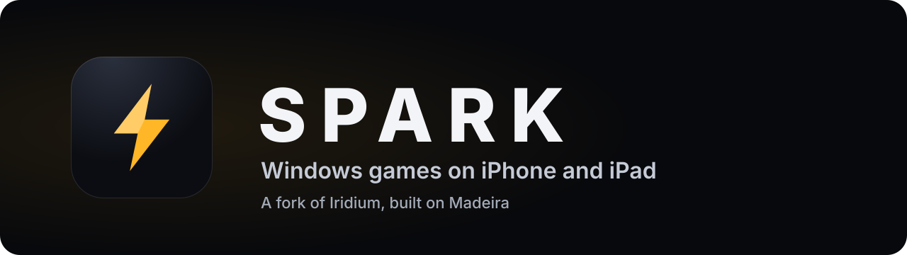

<p align="center">
  
</p>

<p align="center">
  
  
  
  <a href="https://github.com/kazi-kaz/Spark/actions/workflows/build-unsigned-ipa.yml"></a>
</p>

Spark runs Windows games on iPhone and iPad. It is a personal fork of
[Iridium](https://github.com/intraducine/iridium), built on the
[Madeira](https://github.com/willfaust/Madeira) runtime (Wine, the FEX x86
translator and DXMT), with its own runtime fixes and a redesigned interface.

Spark is experimental. Whether a game runs depends on the game, its engine and
the device's memory. Games built with GameMaker, Unity and Ren'Py have run on
device; games that draw with desktop OpenGL do not display yet.

## What Spark adds

**A new interface**, built around the games rather than the settings.

- **Library:** the game you last picked on a large card with Play, filters for
  All Games, Favorites and Stopped, and a grid where every cover shows how its
  last run went. A floating bar reaches Steam, Logs and Settings. Touch,
  keyboard and controller all work.
- **Game page:** artwork with facts read from the game itself (32 or 64-bit,
  engine, Steam DRM, OpenGL, fixed memory address), a Play button, and that
  game's JIT memory and config in one place.
- **Starting a game:** a progress ring and a checklist of the four launch steps,
  so a stall shows where it happened.
- **When a game stops:** the likely cause in plain words, the log line it rests
  on, how far the launch got, and one button to share both logs.
- **In-game panel:** a memory meter that warns before iOS closes the app, frame
  rate and frame time, input settings and the live log.
- **Config editors:** edit `madeira.cfg` and each game's `iridium.cfg` inside
  the app. The Files app can't edit text, so this replaces copying whole files
  over.

**Runtime fixes** on top of Madeira, among them: x64 games importing data from
ARM64EC system libraries, TLS slots in JIT-pool copies, fixed-address
executables, 32-bit (WoW64) thread setup, Ren'Py launch and window handling, a
log reader that leaked memory under Debug Trace, and Steam games started through
Madeira Dock. [CHANGES-FROM-UPSTREAM.md](CHANGES-FROM-UPSTREAM.md) records every
change to third-party code.

## Getting started

1. **Build the app.** Open the
   [Build sideloading IPA](https://github.com/kazi-kaz/Spark/actions/workflows/build-unsigned-ipa.yml)
   workflow, choose **Run workflow**, pick the branch and paste the full commit
   SHA you want to build. Download the IPA from the run's **Artifacts**. The
   first run builds media and Windows-prefix assets and can take a few hours;
   later runs reuse them and take about 45 minutes. To build on a Mac instead,
   see [Build locally](#build-locally).
2. **Install it.** Sign and install the IPA with a sideloading tool such as
   Impactor, SideStore or AltStore. Spark keeps Iridium's bundle identifier, so
   installing over Iridium or an earlier Spark build keeps your games, prefixes
   and config.
3. **Set up JIT.** The runtime needs JIT to translate game code. Open
   **Settings → Launch Support**. Built-in JIT needs debugging
   permission, a pairing file and LocalDevVPN; the
   [JIT guide](iridium/docs/builtin-stikjit-ios27.md) covers each route.
4. **Add a game.** Tap **+** in the Library to import a Windows game folder, or
   choose **Download from Steam** to sign in and download games you own. Then
   tap the game and press **Play**.

## Tuning a game

Every game's page has a **For This Game** card:

- **JIT memory:** Auto, 128, 256, 512 or 1024 MB. Large Unreal Engine games
  usually need 512 MB, and the page suggests it when it detects one.
- **Performance & Config → Edit This Game's Config** opens the game's
  `iridium.cfg`, which overrides the global file for that game only.

**Settings → Global Config** edits `madeira.cfg`, which applies to
every game. Both files take one setting per line; `env.NAME=value` lines are
passed to the game's environment, and lines starting with `#` are comments:

```ini
inproc-sync=0
env.MADEIRA_FASTSYNC=auto
```

[iridium/docs/setup.md](iridium/docs/setup.md) lists the supported keys,
including `jit-pool-mb` and the Steam options.

## When a game won't start

- The stopped screen names the likely cause when it recognizes the log
  signature: missing OpenGL, a missing Windows DLL, incomplete Mono files, a
  rejected launch argument, JIT not attached, or a memory reservation that
  failed. The cause is also saved with the game, and the Library's **Stopped**
  filter lists every game whose last run stopped.
- **Share Logs** sends the app log (`iridium-runtime.log`) and the runtime log
  (`madeira-log.txt`), with the previous run's copies when they exist. Send
  them all when you report a problem.
- For a deeper look, turn on **Debug Trace** under Settings → Runtime → Display
  & Memory. It writes hundreds of megabytes per run, so turn it off afterwards.

Known limits: desktop OpenGL games, Steam's full desktop client (its web
renderer needs more address space than iOS gives the app), and Steam games
without a signed-in account. Spark does not bypass DRM; Steam-protected games
start through Valve's own client components with your account.

## Repository layout

Folder, type and settings names still say `iridium` so existing installs, saves
and build scripts keep working. Spark's app is the Iridium app in this tree.

| Directory | Contents |
| --- | --- |
| `iridium/` | The iOS app, its Swift packages, integration code and tests |
| `iridium/apps/ios/Iridium/Views/` | Spark's screens (`Spark*.swift`, `GameDetailView.swift`, `SettingsView.swift`, ...) |
| `testrepos/Madeira/` | Madeira integration source and its FEX, Wine and DXMT forks |
| `testrepos/madeira-dock/` | Madeira Dock, which starts Steam games through Valve's client |
| `iridium-runtime-sdk/` | Runtime host SDK |
| `iridium-fex-ios/`, `iridium-wine-ios/` | Earlier Iridium FEX and Wine forks |
| `ci/`, `.github/workflows/` | Source checks and the manual IPA build |

Optional external dependencies are pinned in `.gitmodules` and
`DEPENDENCIES.json`; run `git submodule update --init --recursive` when you need
them.

## Build locally

On a Mac with Xcode 27, Python 3.12 or newer, XcodeGen, LLVM and .NET SDK
10.0.403, prepare the runtime dependencies as described in the
[IPA build guide](docs/actions-ipa.md), then run from the repository root:

```sh
bash ci/build-local-ipa.sh
```

The script checks the staged dependencies, builds the Release app without Apple
signing, audits the package and prints the path to `Iridium-unsigned.ipa` (the
file name is kept for compatibility). The main executable carries an anonymous
ad-hoc signature with only the increased-memory-limit entitlement; helpers stay
unsigned. Re-sign the app and its extensions with a sideloading tool before
installing. Later builds reuse `.build/local-ipa`.

## Contributing

Read [CONTRIBUTING.md](CONTRIBUTING.md) first. It covers the change process, the
Spark design rules, the checks to run and how to report test evidence. Before
any commit, run:

```sh
python3 check-public-source.py
```

Never commit signing certificates, keys, provisioning profiles, pairing records,
personal device logs, build outputs or game files.

## License and credits

Spark is a mixed-license repository. Original Iridium code, and Spark's changes
to it, are **AGPL-3.0-only**. Third-party code keeps its own license: Madeira
and Madeira Dock are GPL-3.0-or-later, the Wine source is LGPL-2.1-or-later, and
FEX and DXMT keep their upstream grants. Read [LICENSING.md](LICENSING.md) before
redistributing a build.

Spark exists because of:

- [Iridium](https://github.com/intraducine/iridium), the app this fork starts from
- [Madeira](https://github.com/willfaust/Madeira), for the runtime approach and
  implementation, and [Madeira Dock](https://github.com/willfaust/madeira-dock)
- [Wine](https://www.winehq.org), [FEX-Emu](https://fex-emu.com) and
  [DXMT](https://github.com/3Shain/dxmt)
- Connor Gow's OpenGL work in `c-gow/Madeira`, Moonlight iOS for the touch
  controller pattern, and StikJIT for the built-in JIT route

Required upstream author credits and notices remain intact throughout the tree.
